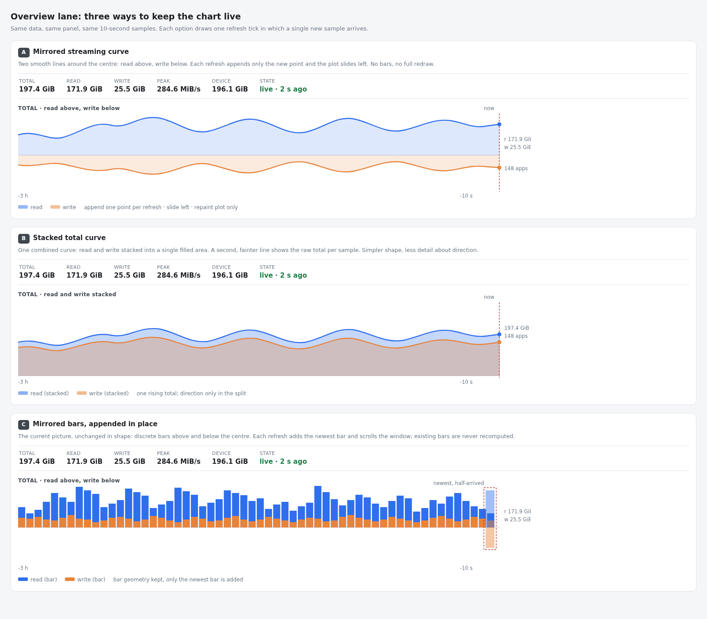

# appio console: a live Overview lane and numbers that stay on screen

Date: 2026-11-15
Status: draft for review (revision 7, after design reviews 1–6)
Amends contracts recorded in `2026-11-01-appio-console-charts-design.md`,
`2026-11-01-appio-console-charts-spec.md`, and
`2026-11-03-silent-daemon-console-recovery-spec.md`. §9 is the exhaustive list;
nothing outside it moves.

## 1. Background

A user screenshot shows the Overview with a full application list, a full Files
table, the status line `updating (loading)`, and all five KPIs reading
`unavailable`. The footer reads
`coverage: incomplete; device attribution: incomplete; tier: rollup_3600s; gaps: 17;
suspends: False; reason: not_retained`, and the detail line reads
`share: this application's totals is still loading from the collector`.
The user reports two symptoms as permanent: the lane is redrawn from scratch on
every refresh, and the numbers are never there.

The frame machine is not broken. The earlier recovery design established that a
preparation per sampled frame is intended, that an applied frame stays on screen,
and that an invalidation retires and replaces exactly one preparation. It left the
**detail layer** (per-application totals and series) and the **chart's maintenance
cost** undecided, and it is the detail layer that produces the screenshot.

### 1.1 The numbers are discarded, re-measured, and painted as absent

| Cause | Evidence | Effect |
| --- | --- | --- |
| A preparation clears every detail part | `HistoryRouter.prepare` resets `self._ranking, self._remote_parts, self._queue, self._cached_parts` (`src/appio/history_router.py:806`) | The selected application's `DiskShare` and `Series` are dropped whenever the window identity changes, which for `since_boot` is every 10 s (`src/appio/ui/collector_window.py:1115-1133`) |
| A detail part bypasses the request queue | `_request_part` appends straight to `self._inflight` (`src/appio/history_router.py:1035-1051`) while `_dispatch` is the only sender that respects `MAX_INFLIGHT = 1` (`:59`, `:890-894`) | `AppIoWindow._load_selected` asks for `series()` then `disk_share()` in one pass (`src/appio/ui/main_window.py:831-895`), so two queries are outstanding; the daemon answers one query per client and refuses the second (`src/appio/iod.py:617-618`, `query_busy`) |
| Remote Files queries also bypass it | `_request_remote_files` calls `self.client.query` directly (`src/appio/history_router.py:403-463`) | A Files page, continuation, or coverage query can hold the connection while a detail request is issued |
| A pending part is painted as an error | `_load_selected` catches `HistoryPending` like any other exception and passes it as `series_error`/`share_error` (`src/appio/ui/main_window.py:852-874`); `build_overview` then emits `Kpi(..., UNAVAILABLE)` for TOTAL/READ/WRITE/DEVICE (`src/appio/ui/render_model.py:528-546`) | Every transient fetch is painted as a permanent absence. PEAK is independent: it comes from the ranking row |
| A real detail failure is swallowed | `_request_part`'s settle callback discards the marker and returns (`src/appio/history_router.py:1053-1063`); the `ready()` collector does the same for a failed part (`:1001-1014`) | A genuine failure is indistinguishable from a fetch in flight |
| A queued part can be published into a later scope | the same callback writes `self._remote_parts[(kind, key)] = value` against whatever cache is current (`:1061`), and `series`/`disk_share` restamp the part with the caller's window (`:1092-1118`, `:1119-1150`) | A part answered for boot A is displayed as boot B. Reproduced by the reviewer |
| A queued answer can carry another subject | the callback stores `done.result()["result"]` without checking the result's external subject; the getters then replace ids (`:1066-1079`, `:1112`, `:1143`) | B's measurement can be shown as A's. Reproduced by the reviewer |
| A frame waits for subject work | `_apply_response` prefetches the ranking's first subject's parts (`:948-952`); `_read_local` builds parts for every ranked application (`:764-770`); `ready()` gates on the whole shared queue (`:1017-1018`) | Every frame pays for subjects nobody selected; locally, the frame cannot complete until every part is built |

### 1.2 The lane is rebuilt in full on every refresh

`SeriesChart.set_task_points` replaces the sample tuple and calls
`_rebuild_geometry` (`src/appio/ui/charts.py:371-381`, `:438-590`), which re-bins
every sample into pixel bins (`:466-478`), re-sums every column, recomputes every
rate, and rebuilds every run's step polygon. A three-hour `since_boot` window is
over a thousand samples re-aggregated to add one 10-second bucket. The frozen spec
requires exactly that shape (`2026-11-01-…-spec.md` §6.2 step 2).

## 2. Goals and success criteria

**Goal.** The Overview describes the selected application live: the numbers are
accepted measurements whose first-seen age is stated, and the lane grows by one
point per refresh instead of being rebuilt.

| # | Success criterion |
| --- | --- |
| AC-1 | Once a measurement is accepted for a subject and retention scope, its dependent values change only when a newer accepted measurement arrives for that scope, when a real failure for that dependency is proved, or when the retention scope or subject changes. A refresh in flight never blanks a value. |
| AC-2 | The panel states how long its displayed answers have been unchanged: `elapsed = now - first_seen` for the oldest displayed answer, computed on the monotonic clock, never reset by re-applying the same accepted answer, and rounded **up** in every unit. It is stated as first-seen elapsed time, never as collector observation age. |
| AC-3 | Every historical query over the client connection — ranking, subject part, Files page, Files continuation, Files coverage — is issued by one scheduler, and the scheduler dispatches the next only when the previous request has a terminal daemon outcome or its connection has been retired. The console produces no `query_busy` of its own making. |
| AC-4 | A frame becomes ready from its ranking, its local ownership/ranking evidence, and nothing else. Subject detail and Files work never gate readiness; they may wait for the transport slot. |
| AC-5 | An append performs O(g) work for the affected column, O(columns) scale work, and O(columns + F + E) geometry work, where F is the emitted run-fragment complexity and E the merged per-column run intervals. Full-sequence validation/diffing and group-growth metadata copying are admitted and counted separately (§6.1). Rebuild and resize paths are exempt and declared. |
| AC-6 | The lane is drawn as a curve, not a step histogram, keeping the mirrored read-above/write-below layout. |
| AC-7 | Every honesty rule of the frozen chart contract survives: a hole is never bridged by a curve or a fill, a column envelope is never proof of continuity, unavailable is never zero, bytes stay exact, each nonzero side's maximum reaches its own half-height, and every run's X order is monotone. |
| AC-8 | Nothing is fabricated: a value never measured for the current scope is `unavailable`, and DEVICE stays `unavailable` while device attribution cannot be proved (§8). |
| AC-9 | A proved failure of a dependency removes its dependent values in the same update, shows the exact reason, and is not undone by a later pending retry. |
| AC-10 | A frame's displayed source position advances only when an accepted answer proves that exact position. A cached answer certifies only the position for which it was originally accepted. |
| AC-11 | A selected subject's detail request is admitted for its retention scope, survives ordinary forward frames inside that scope, and is accepted for the exact window it requested. It is dropped only by subject change, scope change, backward movement, authority change, or supersession. |

## 3. Decision 1 — a pending part is not an error, a failed part is

### 3.1 Four states per slot

The router exposes one settled state per `(kind, app_key)` for the current frame:

| State | Meaning | Panel behaviour |
| --- | --- | --- |
| `pending` | a request for this part is queued or outstanding | keep the retained measurement for the same retention scope, disclose its age |
| `ok(value)` | an accepted, validated answer | accept it as a new measurement |
| `failed(reason)` | refused, failed, timed out, or rejected as invalid | remove the dependent values in the same update and show the reason |
| `absent` | nothing was ever requested for this slot | existing `unavailable` reason |

A later `pending` retry may only produce a new measurement; it can never revive a
value a failure removed (AC-9).

### 3.2 Retention scope, and the lifetime of a detail request

A retained measurement is keyed by a retention scope, coarser than a `Window`:

| Window | Retention scope key |
| --- | --- |
| `range` | `(app_key, "range", boot_id, start_mono_ns, end_mono_ns)` |
| `since_boot` | `(app_key, "since_boot", boot_id)` |
| `lifetime` | `(app_key, "lifetime")`; the active boot is carried as frame/source provenance, never as a `Window` field, because a valid lifetime window has no boot |
| `launch` | `(app_key, "launch")`; launch windows remain A22-refused, so no endpoint or boot semantics are invented |

Each retained measurement carries the exact `Window` it was measured for. Within
one retention scope a measurement stays valid only while the new frame's endpoint is
at or beyond the measured endpoint; a backwards endpoint discards every retained
measurement for that scope before the new frame is displayed. Two different ranges
are always different scopes. The displayed scope is the applied frame's scope; when
it differs from the displayed one, the previous scope's measurements are discarded
**before** rendering. A subject change does the same.

**Detail requests are scope-owned, not frame-owned** (AC-11). A request for a
subject's `totals` or `series` is registered under
`(app_key, kind, retention_scope)` and is **not** cleared by an ordinary
`prepare()` for a forward advance inside that scope. It survives frame generation
changes. It is cancelled or rejected only when the subject changes, the retention
scope changes, the endpoint moves backwards, the connection authority changes, or a
newer accepted measurement supersedes it. Its answer is accepted for the exact
window it requested — never relabelled with a newer window — and it never certifies
the frame's daemon position (§7). Settlement publishes it into the slot's retained
record immediately (§3.5), so an accepted older-window answer is readable through the
scope accessor even while the next frame's own request is pending. Without this rule a
reply slower than one commit cadence would be discarded by every frame and the first
totals measurement could never be accepted.

### 3.3 Availability per dependency

Availability is decided per dependency from the **effective input**: the current
frame's accepted value, or a retained value of the same scope while the current slot
is `pending`. A `failed` slot has no effective input.

| Displayed value | Effective inputs required |
| --- | --- |
| TOTAL, READ, WRITE, donut | share |
| PEAK | the frame's ranking row for the subject (never retained across frames) |
| DEVICE, attribution bars | share with `coverage.device_state == "available"` and a defined `device_total_bytes` |
| residual and reconciliation | share with available device attribution, a defined `device_total_bytes`, **and** a defined `residual_total` |
| device lanes | share **and** series, both `device_state == "available"`, a defined `share.device_total_bytes`, the two effective inputs measured at the same exact endpoint, **and** a single-boot chronology |
| task lane | series |

The effective input is read through `retained(kind, app_key, scope, applied_endpoint)` (§3.5), never
through an exact-window getter, so an accepted older-window measurement stays
displayable while the next request for the same slot is pending.

Incomplete coverage, an undefined PEAK, and unavailable device attribution are
normal, not incompleteness. A newly proved device unavailability applies
immediately to the share-derived values, so an old DEVICE total cannot outlive a
share that proved attribution incomplete. **A series that is device-incomplete
affects only the series-derived device lanes**; it does not remove the share-derived
DEVICE, residual, or bars, because those depend on the share alone.

### 3.4 First-seen age

- An accepted answer's **accepted identity** is the full tuple
  `(kind, external subject, exact Window, data digest)`. The digest is the daemon's
  `snapshot` for a remote answer — which identifies database state independently of
  the requested window (`src/appio/iod_history.py:301-304`) — and for a local answer
  a digest of the local read's payload plus its window. The window and subject are
  part of the identity because two different since-boot endpoints can return the same
  snapshot digest with different totals.
- The first time a given accepted identity is accepted for a slot, it stamps
  `first_seen_at_ns` from the console's monotonic clock. Re-accepting the same
  identity does not restamp it. A local `ok` that re-applies the same identity for
  the same scope is the same acceptance.
- The panel's age is `now - min(first_seen_at_ns)` over the answers that contribute a
  **displayed** value, including the ranking row when PEAK is displayed. Invalidated
  or undisplayed dependencies are excluded.
- If no identity can be established, the panel shows `age unknown`.
- Formatting uses integer ceiling division from nanoseconds in every unit: seconds
  under 90, whole minutes under 90, then whole hours.
- The label states first-seen elapsed time for the oldest displayed answer, never the
  collector's observation age.

### 3.5 The retained record and its accessors

Settlement writes an accepted part into a **retained record** keyed by
`(app_key, kind, retention scope)` *before* it notifies the view. The record holds
the value, its exact measured `Window`, its accepted identity, and its
`first_seen_at_ns`.

- **Capability detection and fallback.** A service that provides only the frozen
  exact-window methods is still valid. The view then installs an adapter that keeps
  its own dependency records using the same rules — accepted identity, measured
  window, first-seen stamp, pending retention, and current-failure clearing — and
  reports `age unknown` where it cannot establish an identity. Retention guarantees
  are therefore identical for both service shapes; only the provenance source
  differs. The adapter is UI-local and never imports the concrete router.
- `retained(kind, app_key, scope, applied_endpoint)` returns the newest accepted
  value for that scope, together with its provenance. The view passes the endpoint of
  the **applied frame**, not of a preparation, so eligibility does not shift while a
  replacement is pending. Endpoint comparison applies only to `range` and
  `since_boot` forms; `lifetime` and `launch` have no endpoint and pass `None`. The
  view composes from this accessor, never from a restamped value.
- The exact-window getters `series()` and `disk_share()` keep their frozen contract:
  they answer for the caller's exact window or raise `HistoryPending`. A mismatch
  with the retained record is not an error and does not make the slot ineffective;
  it only means the exact-window answer is not ready.
- When a replacement request for the same slot becomes pending, the record is
  unchanged until a newer measurement is accepted. `prepare()` never clears it.
- **A current failure clears it.** When a request for this slot settles `failed`, the
  dependency's retained record is cleared before the view is notified, so the
  dependency's values disappear in that same update and no later `pending` phase can
  restore them (AC-9). A *superseded* failure is side-effect free and clears nothing.
  Only a newly accepted successful answer can establish eligible retained input
  again.
- Apart from a current failure, the record is cleared only by §3.2's retirement
  rules: subject change, scope change, backward endpoint, authority change, or
  supersession by a newer accepted measurement.

## 4. Decision 2 — one scheduler, a transport slot that outlives the Future, and a source-specific position

- `_dispatch` is the single sender for every historical query on the client
  connection: ranking, totals, series, Files page, Files continuation, Files
  coverage. Priority: frame ranking, displayed subject's parts, Files work,
  everything else; stable within a priority.
- **Scheduler slot ≠ client Future.** A slot is released only by a terminal daemon
  outcome for that request (a result or an error), by connection loss, or by
  connection retirement. A client-side expiry marks the request `expired` and keeps
  the slot: the expiry settles the Future without cancelling on the wire
  (`src/appio/iodclient.py:1222-1237`) and the daemon keeps `client.job` until the job
  finishes (`src/appio/iod.py:617-623`, `:912-918`). The successor waits. A connection
  with no terminal outcome within the client's silence budget is retired before its
  successor is dispatched. This needs an internal client/scheduler seam; the wire
  protocol does not change.
- A request retired by subject, scope, backward movement, or authority loss is
  dropped before dispatch. A frame-scoped request already on the wire may settle and
  is then discarded. A **scope-owned detail request** is never retired merely because
  a later frame started (§3.2).
- A frame's readiness needs its ranking and the local ownership/ranking evidence
  only: `ready()`'s shared-queue gate (`src/appio/history_router.py:1017-1018`)
  becomes frame-scoped, and the local read is split into ranking/ownership
  preparation and lazily built detail parts (AC-4).
- **Source position.** A frame's requested source is a tagged value captured at
  preparation: `remote(boot_id, epoch, seq)` from `ClientState.cursor`, or
  `local(position_vector)`.
- **Local source position.** Each registered local source is observed through its
  existing long-lived connection — the one its `QueryService` already holds.
  `local_position(source)` is
  `(source name, owner, registration epoch, data_version, total_changes)`.
  The registration epoch changes whenever the registered service is replaced,
  reopened, or re-bound to a different physical source, so a replacement under the
  same name and owner can never repeat an earlier token even when the raw counters
  coincide. `data_version` changes whenever another connection commits and
  `total_changes` changes when this one does, so the pair covers every commit path
  the store has: sampler frames, gap and overlap recording, receipt and epoch
  writes, rollup materialisation, and quota deletion. It is never compared across
  registrations — only a given observer is compared with its own later reading — so
  per-connection counters are a valid change token here. It never assumes a rowid
  (several store tables are `WITHOUT ROWID`) and costs O(1).
- The frame's local position is the **vector** of `local_position` over every
  registered source in name order, so adding, removing, replacing, or reopening a
  source changes it. Preparation captures the vector before the copy and re-reads it
  after the copy completes, with both observations taken outside an active
  transaction so a pinned read cannot hide an external commit; the worker's copy is
  a consistent snapshot by construction. Equal vectors certify that the copy reflects
  the committed content at that position. Unequal vectors mean a commit raced the
  copy, so the frame is uncertified and exactly one replacement is due. The
  **closing observer read is the boundary**: any change observed across the bracket
  is conservatively uncertified, whether it landed before or after the backup cutoff.
  A commit after the closing read is detected by the next current-vector comparison.
- Enqueue dispatches immediately when the slot is free; when it is not, the poll
  drains. The post-drain step notifies the view so a settled part is applied without
  waiting for the next 1 s refresh, and the poll stops only when no frame, detail, or
  Files work remains.

## 5. Decision 3 — settlement is one boundary, and it validates the answer

- Every request carries a unique token: kind, external subject, exact requested
  `Window`, retention scope, owning lifetime, scheduler slot, and connection
  authority at issue time.
- On settlement, in one place, the writer requires: the router is open; the token is
  the slot's current token; the token's owning lifetime is live (frame generation
  current for a frame-scoped request, retention scope current for a scope-owned
  detail request); the authority and scope are current; and the answer's `kind`
  equals the request's kind.
- **Binding is per kind, and the selector's shape is validated before publication.**
  The client's correlated Future is bound to one immutable, normalized
  `QueryRequest`, and the scheduler token owns that association through cache hits
  and settlement. Accepted shapes:
  - `totals`/`series`: a `DiskShare`/`Series` whose `Window` equals the requested
    Window exactly and whose external subject equals the requested subject. The
    external subject must survive the client's decode for these results as it already
    does for Files results (`src/appio/iodclient.py:1200-1206`).
  - `ranking`: a list of valid `AppTotal` rows with unique external identities, plus
    the existing snapshot and pagination ownership checks. No echoed Window exists on
    the wire and none is required.
  - `files`: a `FileTable` that passes the existing request, external-identity,
    snapshot, pagination, and page-consistency checks; those checks are the acceptance
    step of this same settlement boundary, not a second publication path.
  - process coverage: one `Coverage` for a subject, or a mapping of validated
    external keys to `Coverage` when unscoped. Files coverage: a `FileCoverage` with
    its existing scope and identity guards. Unknown-owner coverage: its contract type
    and the existing `UnknownOwnerOverflow` handling.
  A current answer that violates its selector's shape or association settles
  `failed` before publication; an existing broad decoder success is not, by itself,
  the promised validation.
- Only after those checks may the writer publish into the frame's part map or clear
  the pending marker. A superseded answer has no side effect. A current answer that
  fails validation settles as `failed`, never as `absent`.
- `series()` and `disk_share()` are never restamped to a window they were not
  measured for: they keep their frozen exact-window contract and raise
  `HistoryPending` for a window they do not hold. A current-window getter mismatch is
  therefore not "no effective input"; the view composes retained values through
  `retained(...)` (§3.5).
- The callback path, the `ready()` collector, and any local cached-part publication
  all use this one boundary; there is no second writer.

## 6. Decision 4 — the lane becomes an append-only curve

The recorded choice is the mockup's **A**: read above, write below, one smooth line
per side, appended per refresh.


Recorded choice: **A** (mirrored streaming curve), **1** (keep the last measured
value, marked with its age). Mockup set:
`/tmp/pi-mockups/20261115T141655Z-3949621/q1.png`.

### 6.1 Identity and the append contract

`append_task_points(points, *, identity)` and
`append_device_points(points, *, identity)` take an opaque identity token the caller
derives from the data's identity (subject, retention scope, window start, tier, and
for a device lane its device token). The chart stores it and never interprets it.
The full setters `set_task_points` and `set_device_points` remain the rebuild
entries and accept the same optional identity.

Retained append state is: the accepted sequence, the identity, availability, the
column aggregates, each column's member bounds, and each column's canonical
run-interval list. Member bounds are `(first_index, last_index)` pairs, because
groups are consecutive by construction, so group promotion copies O(columns)
bounds rather than O(n) indices. `set_unavailable(reason)` clears the sequence, the
identity, the columns, the curves and the append state, and records the reason.

The decision table is evaluated top-down and is total:

| # | Condition | Action |
| --- | --- | --- |
| 1 | any point fails the frozen validation | raise `ValueError`; retained state unchanged |
| 2 | the retained state is unavailable | full rebuild from `points`; establish availability, reason cleared |
| 3 | `identity` differs from the retained identity | full rebuild; store identity |
| 4 | `points` is empty | become available-empty: no columns, no curves; if already available-empty with the same identity, no-op |
| 5 | the retained sequence is empty and `points` is not | append all points; no tail operation exists |
| 6 | `points` equals the retained sequence **and** availability is already successful with no reason | no-op, no repaint |
| 7 | `len(new) == len(old)` and every element but the last matches (so the last differs) | tail replacement: rebuild that column from its members |
| 8 | `len(new) > len(old)` and `old` is an exact prefix of `new` | appends only |
| 9 | `len(new) > len(old)` and every element but the last of `old` matches (so the shared tail differs) | tail replacement, then appends |
| 10 | `len(new) < len(old)` | full rebuild |
| 11 | anything else | full rebuild |

Rules 7, 8 and 9 are disjoint. The O(n) comparison in rules 6, 8 and 9 is the
admitted budget of AC-5, as is the O(columns) bound copy on group promotion.

Appending adds each sample to the open column, or opens a new column when the
current one is full. Replacing the tail sample rebuilds one column from its member
bounds (O(g)), including peaks, duration and run state, so a lowered or removed peak
is not inherited. Scale is recomputed exactly from the cached columns on every
change (O(columns)); there is no hysteresis, so the frozen "each nonzero maximum
reaches its own half-height" rule holds.

`W`, the pixel budget, still bounds the column count: `g` is the smallest power of
two with `ceil(n / g) <= W`, and when it must grow, adjacent column pairs merge —
bytes and durations add, peaks take the defined maximum, `starts_run` ORs,
envelopes take min/max, member bounds concatenate.

### 6.2 Geometry that cannot bridge a hole

- **Support, not envelope.** For each column, each run fragment inside it is clipped
  to the column and to the fragment's own `[start, end)`; the candidate vertex x is
  that clipped interval's midpoint and its y is the column's rate height. A column
  holding two separated runs yields two vertices at two different x positions,
  neither inside the hole.
- **Canonical intervals.** Within a column, touching fragments of the same run
  coalesce; separate fragments stay separate. Merging two columns concatenates their
  interval lists in time order and coalesces only intervals that touch at the merge
  seam. Cross-column fragments keep distinct vertices because their heights may
  differ.
- **Monotone, inset construction.** Let the run's mapped support be `[s, e]` and
  `inset = min(0.25, (e - s) / 4)`. Candidate vertices are ordered by x; then the
  first is raised to at least `s + inset`, the last is lowered to at most `e - inset`,
  and each later vertex is clamped to be at least its predecessor and at most
  `e - inset`. Heights are unchanged, so the side's maximum amplitude survives; a
  subpixel run may collapse several vertices onto one x, which is legal and monotone.
- The stroke is one polyline per run and side through its final vertices in time
  order. The fill closes that polyline to the centre line at the first and last
  vertex x.
- A run with a single fragment produces two vertices at its own support edges, inset
  as above, at the same height.
- An all-zero side emits no segment. Nothing is interpolated across a hole, and no
  two separated fragments are ever joined to satisfy the column budget.
- Cost is O(columns + F + E), where F counts emitted fragments and E counts merged
  per-column run intervals; a dense contiguous series has E ≈ columns.

### 6.3 Device lanes and composition panels

`DeviceLane` uses the same append contract with an identity that includes the device
token, and never inherits task suspension metadata. The donut, share bars and KPI
labels keep their existing value-diffing (`src/appio/ui/main_window.py:985-1030`).

## 7. Frame identity, certification, and the trigger

- A frame's **requested source** is captured at `_submit_prepare` (§4): a remote
  cursor or a local position vector. It is a request, not evidence.
- Every accepted answer records its **answered source**: for a remote answer, the
  cursor the request was issued at; for a local answer, the bracketing position
  vector captured around the copy. Cache entries carry the answered source they were originally accepted
  for.
- A frame is **certified** when its ranking's answered source equals the frame's
  requested source. A cached answer therefore certifies exactly the position it was
  originally accepted at: a hit at the same cursor certifies, a hit at an older
  cursor does not. A failed ranking, or one served from local fallback, certifies no
  daemon position.
- To make the older-cursor case impossible in the first place, the client's cache key
  includes the full cursor triple, not `boot_id|iod_epoch`
  (`src/appio/iodclient.py:854-866`, `:1281-1283`).
- `displayed_source` advances only to the requested source of a certified frame. A
  prepared-but-uncertified frame may display its own data, honestly labelled, but
  does not mark the position as displayed, so the trigger keeps firing.
- A new preparation is due when: the desired retention scope differs from the
  displayed one; the displayed source is uncertified for the current requested
  source; the daemon is `verified and answering` and its current cursor differs from
  the displayed remote source; the console is in local mode and the current local
  position vector differs from the displayed one; or the operator made an explicit
  request.
- A clock endpoint advance with an unchanged certified source is **not** a trigger.
- While a preparation is pending, further source advances coalesce into exactly one
  replacement after it applies. Retirement, explicit requests, stall and retry-floor
  ownership, and probe reconciliation stay with the frozen shell contract.

## 8. Deliberately unchanged: DEVICE and the per-disk lanes

DEVICE, the residual strip and the device lanes stay `unavailable` while device
attribution cannot be proved for the whole window: `require_device` marks coverage
`incomplete` whenever the window is not fully retained
(`src/appio/query.py:874-877`) and the renderer requires
`device_state == "available"` (`src/appio/ui/render_model.py:520-530`). A
`since_boot` window that begins before the collector retained anything is therefore
permanently `incomplete`. The screenshot's `gaps: 17` is consistent with that; the
gap count alone does not prove it, and this design claims no per-gap cause.

This design does not relax that rule. A device total over a partly retained window
would sit beside a residual equation that cannot be balanced. Reporting device
attribution over retained intervals only is a separate accounting decision and is out
of scope.

## 9. Amendments to frozen contracts

Every row names the frozen location being changed, its replacement, and what remains
in force. Nothing else in those documents changes.

| Frozen location | Change | Remains in force |
| --- | --- | --- |
| charts-spec §3.2 `set_task_points` as the only entry | `append_task_points`/`append_device_points` added; full setters accept an identity (§6.1) | validation, rebuild semantics, `set_unavailable` |
| charts-spec §3.2 `segments()` as the only geometry accessor | `curves()` returns stroked polylines; `segments()` keeps returning closed fill outlines | `ChartSegment` fields and validation |
| charts-spec §2.2 `build_overview` requires every part at the requested Window | parts are accepted per dependency with their own measured Window, provided the retention scope matches and the endpoint is not beyond the requested one; the model carries each part's measured window and first-seen stamp (§3.2–§3.4) | per-dependency availability rules, exact byte rendering, refusal of contradictory subjects |
| charts-design §6 error table and charts-spec §8 error table: `disk_share()`/`series()` raise → dependent KPIs/lanes unavailable | `pending` keeps the retained measurement; `failed` removes it; availability is per dependency (§3.1, §3.3, §11) | `unavailable` never rendered as zero; independent PEAK |
| charts-spec §6.2 step 2 pixel-bin assignment | bucket-anchored power-of-two groups merged pairwise (§6.1) | `len(columns()) <= W`, one contribution per sample, envelope/peak/`starts_run` aggregation |
| charts-spec §6.3 step-fill as the drawn shape | polyline stroke plus the same closed fill outline with per-run support vertices and a monotone inset construction (§6.2) | exact scales, per-side maxima, hole exclusion, epsilon inset, byte arithmetic |
| charts-spec §7 and recovery-spec §4.3 status text, with the exact-text obligations of recovery-spec §8 (recovery-spec §4.4 transition ownership is **not** amended) | one composer with the decision tree in §10; a separate age label carries `oldest answer <age> ago` so frozen texts stay exact; the new `updating`, `live`, `loading measurements` and `measurements unavailable` templates are added | the frozen stall, busy, retry, refusal, `loading history`, `waiting for the first sample` and `no applications observed` texts |
| charts-design §5.5–§5.6 and charts-spec §4.2 target-Window-driven preparation | preparation triggers become source-driven: the endpoint-only clock trigger is **suppressed** when the certified source is unchanged, and source-change and uncertified-source triggers are **added** (§7) | retirement, coalescing, stall/retry floors, explicit requests, `_pending`/`_displayed` ownership, probe reconciliation |
| charts-spec §1 "no change to router signatures"; the eager local detail construction at `history_router.py:738-770` | the router gains per-slot settled state, scope-owned detail requests, a retained-record accessor, per-part measured-window provenance and first-seen stamps; the local read prepares ranking/ownership only and builds detail lazily (§3.2, §3.5, §4, §5) | the router's existing public query contracts and refusal behaviour |
| (new) `HistoryRouter` has no retained-record accessor | `retained(kind, app_key, scope, applied_endpoint)` is added, populated by settlement before view notification, and cleared by a current failure (§3.5); exact-window getters keep their contract | `series()`/`disk_share()` exact-window answers and `HistoryPending` |
| charts-spec §2.1 exact dataclass-field inventory; §3.3 the UI-local `QueryService` protocol | the Overview model carries per-dependency provenance (measured Window, accepted identity, first-seen stamp) and the view consumes the retained-record seam; the UI protocol gains an optional retained-capability so a service that provides only exact-window queries still satisfies it, and the view never imports the concrete router | the prohibition on importing the concrete router into the view; exact-window query semantics |
| (new) local source identity has no defined position | `local_position(source)` is `(name, owner, registration epoch, data_version, total_changes)` over each source's existing long-lived connection; a frame carries the vector over all registered sources (§4, §7) | no change to the store schema or to any writer |
| charts-design §5.5–§5.6 and charts-spec §3.5, §4.2, §4.5 (no-frame early return, apply, timer lifetime) | `apply_ready_frame`'s no-frame path drains detail work and notifies the view; the poll stops only when no frame, detail, or Files work remains; a scope-owned detail request survives forward frames (§3.2, §4) | the pump's transport-only role, the single apply path, and recovery-spec §4.5's unchanged preparation-error seam |
| client cache key `boot_id\|iod_epoch` (`iodclient.py:1281-1283`) | the key includes the full cursor triple; entries carry their answered source (§7) | cache bounds, eviction, read-through semantics |
| client transport ownership on expiry (`iodclient.py:1222-1237`) | a scheduler slot is released only by a terminal daemon outcome, connection loss, or retirement (§4) | the five-second expiry, its Future settlement, and the wire protocol |
| `Series`/`DiskShare` decode metadata | the external `app_key` is preserved for these results as it already is for Files (§5) | decoded field contracts |
| Files query dispatch (`history_router.py:403-463`) | Files page/continuation/coverage go through the shared scheduler (§4); their existing request, identity, snapshot, pagination and page-consistency checks become the acceptance step of the single settlement boundary (§5) | Files rendering, paging, and accounting contracts |
| (new) no registration identity exists for a local source | the registration epoch in `local_position` changes on replacement, reopening, or re-binding, so a replaced source can never repeat an earlier token (§4) | `HistoryRouter.add_source`'s existing generation invalidation |

## 10. Status line: one owner, exhaustive outcome

`CollectorWindow` composes two independent widgets, so a frozen text never has to
absorb an age:

- the **status label**, whose text is decided by the decision tree below;
- the **age label**, shown exactly when a measurement is displayed, with the text
  `oldest answer <age> ago`, or `age unknown` when no accepted identity exists. It is
  updated by the clock tick and by every model change, issues no query, and is never
  suppressed by a status row. This is why a stalled reader, a retry floor, or a
  refusal keeps its frozen wording and still shows the age of the numbers beside it.

Frozen predicates are imported unchanged: `stall_eligible = self._stalled or
self._retry_after is not None`; busy means `stall_eligible and
history.local_read_in_flight` (`src/appio/ui/collector_window.py:864-907`).

The status label is decided by this ordered tree. It is exhaustive by construction:
every branch either returns text or falls through to a branch that does.

```text
1. a WindowUnavailableError refusal is displayed        -> frozen refusal text, verbatim, no prefix
2. a PrepareRetry operational failure is displayed      -> frozen `appio: …` text
3. busy (stall_eligible and the local reader in flight) -> frozen `history read has not completed
                                                            (<state>); the reader is still busy`
4. _retry_after is not None and now < _retry_after       -> frozen `history read has not completed
                                                            (<state>); retrying in <n> s`
5. no applied frame:
   5a. no target or no sample                           -> frozen `waiting for the first sample`
   5b. otherwise                                        -> frozen `loading history (<state>)`
6. an applied frame exists:
   6a. has_displayed_values and any work in flight      -> `updating (<state>)`
   6b. has_displayed_values                             -> `live`
   6c. the ranking is successfully empty                -> frozen `no applications observed`
   6d. any dependency is `pending`                      -> `loading measurements (<state>)`
   6e. no dependency is `pending` and one is `failed`   -> `measurements unavailable: <first reason
                                                            in the fixed order share, series>`
   6f. otherwise                                        -> no status text
```

`has_displayed_values` means at least one of TOTAL, READ, WRITE, DEVICE, or the task
lane is currently rendered from an accepted input. A successfully applied frame is
not a displayed measurement: 6c–6f keep a settled empty, unranked, pending-first,
failed, or unsupported-chronology panel from claiming to be loading, and 6f covers
the frozen cases whose reasons live in the panel itself (`not in the process
ranking`, `lifetime chronology unavailable`).

## 11. Error behaviour

| Situation | Behaviour |
| --- | --- |
| No displayed frame, acquisition in progress | §10 5a/5b; dependent values `unavailable`; no fabricated value |
| Applied frame, displayed dependent values, work in flight | retained values stay; §10 6a |
| Applied frame, acquisition in progress, no displayed values (first load, or retry after invalidation) | §10 6d unless a higher-priority frozen row wins; dependents `unavailable`; PEAK stays independently governed by the ranking row |
| A slot settles `failed(reason)` | its dependent values are removed in that update; the exact reason is shown; a later pending retry cannot restore them |
| Share `ok`, series `failed` | TOTAL/READ/WRITE and the donut keep the new measurement; the task lane shows the series failure; device lanes are unavailable |
| Share `ok`, series device-incomplete | TOTAL/READ/WRITE, donut, **DEVICE**, residual and bars keep the share-derived values; only the device lanes are withheld |
| Share `failed`, series `ok` | the task lane keeps its measurement; TOTAL/READ/WRITE, DEVICE, donut, residual and bars show the share failure |
| Share `ok` with unavailable device attribution | TOTAL/READ/WRITE and the donut update; DEVICE, residual, bars and device lanes become unavailable in the same update |
| Share and series measured at different endpoints | task lane from the series; device lanes withheld with their disclosure; share-derived values unchanged |
| Scope or subject changes, or an endpoint moves backwards | retained measurements for the old scope are discarded before rendering |
| A superseded or invalid answer settles | superseded: no effect. Invalid: `failed`, never `absent` |
| A scope-owned detail request outlives a forward frame | accepted for its requested window; displayed as a retained measurement, never relabelled |
| The lane receives a sequence contradicting the retained one | full rebuild (§6.1 rule 11) |
| An available empty series | frozen `no samples in this window` |

## 12. Test strategy

Deterministic, offscreen; no real daemon, wall clock, or root.

1. **Settlement validation.** Wrong kind, wrong subject, wrong Window, superseded
   generation, superseded connection, duplicate settlement, and a per-selector shape
   violation: a `Coverage` where a `DiskShare` was requested, a coverage mapping whose
   values are not `Coverage`, duplicate ranking identities, and a Files-scoped
   coverage answer for a process-coverage slot. Delayed success and delayed failure
   across scope, boot, subject and generation.
2. **Real failures reach the panel, and the record is cleared.** `RemoteError`,
   refusal, transport failure, timeout and `invalid_result` each become `failed`;
   the retained record for that dependency is cleared before the view is notified;
   a following pending retry restores nothing. The sequence success → current
   failure → pending retry is exercised through the real retained accessor and view
   with an undefined PEAK and an independently successful other dependency.
3. **Dependency independence.** Assert DEVICE, reconciliation, bars, device lanes and
   the task lane separately for: share `ok` with series pending; share `ok` with
   series failed; share `ok` with series device-incomplete; share device-incomplete;
   available coverage with an undefined `device_total_bytes`; lifetime chronology;
   defined device total with undefined residual; mixed measured endpoints; retained
   share with a newer series and the reverse.
4. **Detail liveness under continuous commits.** Fixture, stated exactly: rank
   admission at 0.0 s and an answer at 0.2 s; series issued at 0.2 s and answered
   4.95 s after issue; totals issued after series settles and answered 4.95 s after
   issue, so the totals reply lands at 10.1 s, after the 10 s preparation of the next
   frame. Each wire reply is below the five-second client timeout; only the queue
   lifetime crosses the commit. Assert that every completed totals reply settles,
   that the retained record exposes it under its own measured Window, and that TOTAL,
   READ and WRITE become visible with an undefined PEAK — including the case where
   the reply lands while the replacement frame is pending. Also: a held local detail
   released after frames advanced is accepted exactly once.
5. **Certification.** A cursor advance whose ranking is served from the older
   sequence's cache does not certify; a same-cursor cache hit certifies the position
   it was originally accepted for; a failed or local-fallback ranking certifies
   nothing. For local mode: a position vector over all registered sources changes on
   an older-row deletion, a rollup deletion, an in-place epoch or receipt update, a
   change confined to a non-primary source, source addition or removal, and
   replacement or reopening of a source whose raw counters coincide with the
   previous one; repeated unchanged ticks are quiescent and issue no preparation.
   Three bracket schedules are separate cases: a commit during the backup, a commit
   after the backup but before the closing observer read, and a commit after the
   closing read. The first two leave the frame uncertified with exactly one
   replacement due; the third leaves the frame certified and is caught by the next
   current-vector comparison.
6. **Scheduling and transport slots.** One outstanding request across ranking,
   detail, Files page, continuation and coverage. A timed-out request whose daemon
   job is still held keeps the slot; the successor waits or the connection is retired
   first. Frame readiness is unaffected by outstanding detail or Files work.
7. **Chart decision table.** One test per reachable row: unavailable→available-empty,
   unavailable→same points, empty→nonempty, setter→append, lowered or removed sole
   peaks, `None` versus zero, suspend change then append, contradicted sequence.
8. **Chart geometry.** Two or more separated runs in one column: every curve and fill
   X-support sits strictly inside one run's support. Eight-fragment subpixel runs,
   two-fragment runs, unequal heights, closed fills, and monotone X inside the inset
   bounds. Single-fragment run draws a tick. Contiguous data yields one interval per
   column. Fragmented input with F much greater than W is handled and counted.
   Group promotion copies bounds, not member indices.
9. **Scale invariants.** Each nonzero side's maximum reaches its own half-height
   after appends, merges and tail replacements; zero stays zero.
10. **Age.** Ceiling division at 0, 1 ns, just under 1 s, 89.999 s, 90 s, 89.999 min
    and 90 min; a changed selector with an unchanged snapshot digest restamps; a
    repeated identical identity does not; a repeated local application does not;
    mixed dependency ages use the oldest displayed answer; an identity-less source
    reports `age unknown`.
11. **Status and age.** Evaluate the §10 tree as a function over the reachable
    combinations and assert exactly one branch is selected: initial-frame pending,
    first-details pending with no PEAK, retry pending with no PEAK, ok-series with
    failed-share and undefined PEAK under unsupported lifetime chronology, a settled
    unranked file-only subject in a nonempty ranking, a refusal versus an operational
    error, and early retirement with an expired floor plus a still-held worker. The
    age label is asserted independently in every branch where a measurement is
    displayed — busy, retry floor, refusal, and idle — and asserted absent where none
    is displayed.
12. **Backward and range transitions.** Backward since-boot requests discard before
    display; backward-then-forward behaves from the reset; range-to-range, subject
    and boot changes each clear.

## 13. Out of scope

- The collector's 10-second cadence and any sampling change.
- Device-attribution policy (§8).
- The Files tab's rendering and contracts; only its query scheduling moves (§4).
- Any change to `appio.query.QueryService`, the store schema, the daemon wire
  protocol, or the ownership/receipt model. The UI-local query protocol amendment of
  §9 is in scope; the concrete `QueryService` is not.
- Any new scope control or range picker.
