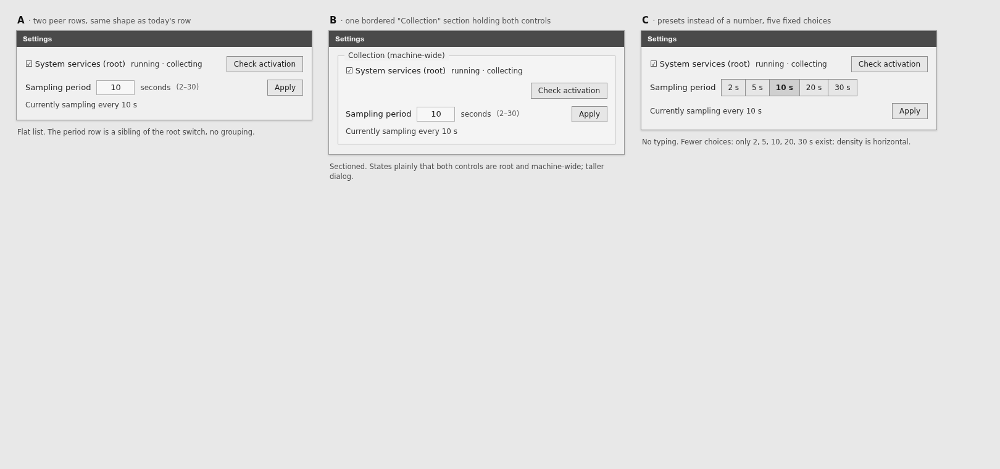

# Adjustable sample period — design

- **Topic:** `sample-period-settings`
- **Run:** `pm-run-20261117-153438-045b6e15`
- **Date:** 2026-11-17
- **Status:** revised after the round-1 design review (23 findings), awaiting re-review

## 1. Background

The system collector measures application I/O in fixed windows and commits each window
to SQLite. Today that period is a module constant:

| Fact | Where |
| --- | --- |
| `SAMPLE_NS = 10 * NS` — the measurement period | `src/appio/iod.py:42` |
| `MAX_FLUSH_NS = 30 * NS` — the commit ("overdue") window | `src/appio/iod.py:44` |
| `Daemon(..., sample_ns=SAMPLE_NS, flush_ns=MAX_FLUSH_NS)` | `src/appio/iod.py:263-271` |
| `flush_ns` must be strictly greater than `sample_ns`, enforced in the constructor | `src/appio/iod.py:267-270` |
| `_flush_ns` gates two paths: an elapsed-time check inside `_sample` that raises `collection_overdue` | `src/appio/iod.py:824`, `:853` |
| and a shutdown check that sets `_recover` when more than `_flush_ns` has passed since the last commit | `src/appio/iod.py:967` |
| The production entry point is module-level `main()`, which constructs `Daemon()` with defaults | `src/appio/iod.py:973-981` |
| The shipped cadence is pinned by tests on production defaults; one asserts three raw observations across fifteen 2 s ticks | `tests/p3/test_iod_cadence_pins.py:16-33` |
| A deployment tunable already lives in the unit as `Environment=` | `data/systemd/appio-iod.service` (`APPIO_QUOTA_BYTES`) |
| A malformed environment override falls back to the default rather than failing | `src/appio/quota.py:73-91` |
| Raw history is kept 1 day, 60 s rollups 30 days, hourly rollups 365 days; the store is size-capped (1.5 GB default, 8 GB on the packaged unit) | `src/appio/quota.py:24`, `:49-51` |
| A maintenance pass retires at most 2048 units and currently runs once per minute | `src/appio/quota.py:25-32`; `src/appio/iod.py:45`, `:864-880` |
| The Settings dialog has exactly one row (`ROWS = ("system_services",)`), one privileged switch, a probed status label, and "Check activation" | `src/appio/ui/collector_window.py:408-455` |
| The consent dialog and its text are keyed by verb and defined only for `enable`, `disable`, `status` | `src/appio/ui/collector_window.py:192-205`, `:280-324` |
| Privileged changes go through `/usr/bin/pkexec /usr/bin/appio-setup <verb>`; the installed shim, the client and the service each validate argv | `data/libexec/appio-setup:220-221`; `src/appio/setup_client.py:149-165`; `src/appio/setup_service.py:234-239`, `:279-301` |
| Two fixed configuration targets exist, both written atomically under an `O_NOFOLLOW` component walk with an expected-content check | `src/appio/setup_boundary.py:206-227`; `src/appio/setup_files.py:64-67`, `:706-718` |
| The collector's request vocabulary is read-only (`status`, `subscribe`, `query`) | `src/appio/ipc_models.py:77` |
| The status reply is validated against an exact key set on both sides | `src/appio/ipc_models.py:603-630`; `src/appio/iod.py:531-536`; `src/appio/setup_service.py:349-352` |
| `ServiceFacts` carries service and daemon facts but no period | `src/appio/collector_owner.py:35-62`; `src/appio/ui/collector_window.py:1512-1567` |
| Note: `appio --interval` is the console's refresh *and* local-collection cadence, separate from the system service | `src/appio/__main__.py:33-37`, `:60-70`; `src/appio/ui/collector_window.py:1215-1221` |

So the measurement period is neither adjustable nor visible: an operator who wants
finer or coarser measurement must patch a constant, and the console cannot report
what the collector is actually doing. A 1-day raw window and a size-capped store make
the period a product trade-off, not an internal detail.

## 2. Goal

One machine-wide setting, changed from the application's Settings dialog, that sets
how often the **system service** measures application I/O.

Success criteria, each observable:

1. With no setting, the collector commits at 10 s exactly as today, including through
   the real production entry point.
2. Setting 2 s produces committed intervals of about 2 s; 30 s produces about 30 s;
   the collector's status reply reports the value in use.
3. Over ten minutes at 30 s, neither overdue path fires from a normal cadence.
4. `1`, `31`, `abc`, `02`, `" 5"`, a control character, and a 4,000-character value
   each leave the collector at 10 s, log exactly one single-line diagnostic, and let
   startup complete.
5. Applying a value while collection is off writes the configuration and does **not**
   start or enable collection; applying while it is on restarts it.
6. Applying the same value twice, the second time after a successful first apply,
   writes nothing and does not restart. A second apply after a *failed* reload or
   restart repairs the state instead of reporting `unchanged`.
7. A non-empty drop-in that is not canonical is refused and left byte-identical.
   (An exactly canonical file is treated as the helper's own; canonical bytes cannot
   prove authorship, so this is the honest rule — see D9.)
8. Sustained operation at the supported minimum keeps retention ahead of production
   on a 200+ application host, proven by a measured characterization run.

## 3. Non-goals

- Changing the period without restarting the system service.
- Per-user periods, or a period for the console's own local collection.
- Retention, quota, rollup-granularity, or schema changes (D12 changes only *when*
  maintenance runs, not what it does).
- Any change to the read-only request vocabulary (`status`, `subscribe`, `query`).
- Changing `appio --interval` or the GUI-owned local collector.

## 4. Decisions

**D1 — The setting is an integer number of seconds, 2-30, in
`APPIO_SAMPLE_SECONDS`.** Seconds because the helper, the drop-in, the dialog, and the
log line all speak seconds; the collector converts once at startup.

**D2 — Parsing is pure; logging is separate. An invalid value is ignored, never
clamped.**

- `PERIOD_TEXT = re.compile(r"(?:[2-9]|[12][0-9]|30)", re.ASCII)` — canonical
  decimal, 2..30, no sign, no leading zero, no whitespace.
- `parse_sample_seconds(raw) -> int | None` is pure: `None` unless `type(raw) is str`
  and `PERIOD_TEXT.fullmatch(raw)`. Because the pattern is anchored and at most two
  characters long, no unbounded integer conversion is possible.
- `configured_sample_ns(environ=None) -> int` reads one key
  (`environ if environ is not None else os.environ`), returns `SAMPLE_NS` when the key
  is absent or empty, `seconds * NS` when it parses, and otherwise `SAMPLE_NS` after
  emitting exactly one warning: `sample_period_invalid value=<escaped>`, where
  `<escaped>` is the value's `repr` truncated to 64 characters, so control characters
  can never split the line.
- Only module-level `main()` calls it, never `Daemon.__init__`'s default arguments:
  embedders and `tests/p3/test_iod_cadence_pins.py` stay deterministic.
- The collector never fails to start because of this setting.

**D3 — The commit window becomes `max(30 s, 3 x period)`
(`flush_ns_for(sample_ns)`).** `flush_ns` must exceed `sample_ns`; a fixed 30 s window
would make a legitimate 30 s cadence trip `collection_overdue` on the first scheduling
jitter. Three periods keeps both overdue paths meaningful and leaves 2-10 s periods at
least as forgiving as today. The shutdown path at `iod.py:967` requests recovery under
the same derived threshold, and the design states that as intended: a shutdown after
more than three missed cadences marks the run for recovery.

**D4 — The collector reports the period it is using.** The status reply gains
`sample_ns` (positive integer, nanoseconds, at most 30 s). Both validators change:
`ipc_models._status` keeps its current required keys and adds `sample_ns` to the
allowed set, validated as a positive integer; the daemon's `_status()` emits it from
the constructor value, never from the environment.

Compatibility is honest, not optimistic: a console process built before this change
holds the *old* exact-key validator, treats the extra key as a protocol error, and
therefore shows the collector as unavailable until it is restarted. It never displays
a wrong period. The package ships both sides, so the window is one console restart.

**D5 — Persistence is a third fixed helper target.**
`/etc/systemd/system/appio-iod.service.d/20-sample-period.conf`, canonical bytes:

```
[Service]
Environment=APPIO_SAMPLE_SECONDS=<n>
```

`<n>` is canonical decimal and the file ends with exactly one LF.
`sample_period_payload(seconds) -> bytes` and
`parse_sample_period_dropin(data) -> int | None` ("not ours") live beside the existing
payload/parse pairs.

The target must be added to **both** `FIXED_TARGETS` (for path resolution) **and**
`FIXED_CONFIG_TARGETS` plus `_require_expected_content` (for the write boundary).
Without the second, `SafeRootFS.atomic_write` refuses the path with
`unexpected_content:not_a_config_target`. The menu of enforced rules at the write
boundary, all inherited from the existing targets: 0644 mode, root ownership,
single-link regular file, size under `MAX_TARGET_BYTES`, `O_NOFOLLOW` component walk,
`mkstemp` + write + `fsync` + `fchown` + `rename` + parent `fsync`.

Missing parent directories are created by `_open_or_create_child` with the fixed
directory modes. The design requires one addition there: after creating a directory,
`fsync` its parent, so a created `appio-iod.service.d/` survives a crash with the same
guarantee as the file it will hold.

**D6 — One argument-carrying verb, plumbed end to end.** Every layer that validates
argv must accept it, or the feature is unreachable:

1. **Installed shim** (`data/libexec/appio-setup`, must stay stdlib-only): its `VERBS`
   gains `set-sample-period`; the syntax check becomes
   `len(argv) == 2 and argv[1] in VERBS_WITHOUT_ARGUMENT` **or**
   `len(argv) == 3 and argv[1] == "set-sample-period" and _CANONICAL_PERIOD.fullmatch(argv[2])`;
   every other shape exits 2 with the existing usage message. The regex is duplicated
   in the shim on purpose: the shim may not import `appio` before verifying the module
   closure, and the duplication is one anchored pattern checked by the same tests.
2. **Boundary** (`setup_boundary`): `VERBS` gains the verb; `Invocation` gains
   `period_seconds: int | None = None`; `parse_invocation` accepts three elements only
   for this verb and returns the parsed integer. A canonical value outside 2-30 raises
   `InvocationError(2, "sample_period_out_of_range")`; any other payload shape raises
   `InvalidVerbOrArgumentCount` semantics (`invalid_verb_or_argument_count`).
3. **Dispatch** (`setup_service.dispatch`): the internal re-validation synthesizes the
   same three-element argv (`("/usr/bin/appio-setup", verb, str(payload))`) so the
   payload survives; a `set-sample-period` invocation whose `period_seconds` is `None`
   is refused as `invalid_verb_or_argument_count`, so a forged internal invocation
   cannot bypass the check.
4. **Entry point** (`setup_service.main`): `_valid_syntax` must report *which* syntax
   error occurred and print that reason, instead of collapsing every exit-2 error into
   `invalid_verb_or_argument_count`; otherwise `sample_period_out_of_range` never
   reaches the operator.
5. **Client** (`SetupClient.invoke`): `invoke(verb, *, period_seconds=None)` appends
   the payload only for this verb; a payload for another verb, or a missing payload
   for this one, raises `ValueError` before any launch. `HELPER_ARGV` stays the fixed
   two-element vector.
6. **Result decode**: `decode_body` accepts and validates a new optional integer field
   `sample_period` (D7) in addition to today's `_BOOLEAN_OR_NONE` and `_TEXT_OR_NONE`.

**D7 — Applying means write, reload, conditional restart, then verify.**

The helper performs, under its existing lock:

1. Read the target bytes (`None` when absent).
2. Refuse a non-empty, non-canonical file with exit 2 `foreign_drop_in` and the path.
3. `needs_write = existing != canonical_bytes`.
4. Read the configured value from the manager:
   `systemctl show -p Environment -p DropInPaths -p UnitFileState -p ActiveState
   appio-iod.service` — the merged view, which is what the manager will start with.
5. Write when `needs_write`.
6. `systemctl daemon-reload` when `needs_write` or the configured value already differs
   from `<n>`; failure exits 1 `daemon_reload_failed`.
7. `systemctl try-restart appio-iod.service` when the unit is active **and** any of:
   `needs_write`, configured-before differs, or the running daemon reports a different
   value. `try-restart` restarts only an active unit, so it cannot start collection and
   the check-then-restart race disappears. Failure exits 1 `service_restart_failed`.
8. Verify: the merged `Environment=` value equals `<n>`, and — when the unit is active
   — the daemon's own status reply reports `sample_ns == n * NS`. A mismatch exits 1
   `sample_period_not_in_effect` naming both observed values.
9. Report `applied` when a write happened and verification passed; `unchanged` when no
   write, no reload, and no restart were needed and verification passed on the first
   observation; `applied_not_running` when the unit is inactive and the configuration
   verified.

The identical-bytes path therefore never *asserts* an old value: when the bytes match
but the configured value, the running value, or a previous operation's completion is
missing, the helper still reloads and `try-restart`s. That is the repair path from
F3, and it is what makes criterion 6 true in both directions.

If another drop-in, `EnvironmentFile=`, or `UnsetEnvironment=` wins, step 8 reports
`sample_period_not_in_effect` and names the observed value and `DropInPaths`, so an
operator can see which file won instead of guessing.

**D8 — The dialog shows the collector's value, bound to the requested value.**

- `SettingsDialog.ROWS` gains `"sampling_period"`; the row is
  `Sampling period (system service)  [ 10 ] s  (2-30)  [Apply]` with the status line
  beneath it. `focus_row("sampling_period")` focuses the spin box.
- `QSpinBox` with `setRange(2, 30)`, `setSuffix(" s")`, `setKeyboardTracking(False)`.
  Initial value: the last reported `sample_ns` converted to seconds, else 10.
  A refresh never overwrites an edited-but-unapplied value; the edit is preserved and
  the status line keeps reporting the collector's value independently.
- Apply keeps a `pending_period`. Success is shown only when a probe reports
  `sample_ns` equal to `pending_period`; a probe reporting any other value shows
  `Requested N s, collector reports M s.` and clears nothing silently. A superseded
  operation (another console applied a different value) surfaces as that same
  mismatch, never as success.
- `ServiceFacts` gains `sample_ns: int | None` (validated positive int or None);
  `production_probe` passes the status reply's value through. The value is retained in
  the existing probe payload and invalidated on disconnect, restart, or a generation
  change, exactly like the other probed facts.
- Exact status strings:

| Situation | Status line |
| --- | --- |
| verified match | `Sampling every N s.` |
| collector not answering | `Sampling period not known while the collector is not answering.` |
| answering but the field is absent (older daemon) | `Sampling period not reported by this collector.` |
| applied while inactive | `Saved: sampling every N s once the system service starts.` |
| helper failed before changing anything | the helper's bounded first stderr line |
| apply completed, value not in effect | `Requested N s, collector reports M s.` |

- When the daemon is not answering, Apply stays enabled: it is the repair path.
- Helper availability is not pre-detected. A missing helper or a cancelled
  authentication produces the launcher's failure and the helper's exact first stderr
  line, bounded as today (`first_stderr_line`, `MAX_STDERR_BYTES`).

**D9 — Foreign content is refused; canonical content is ours.** A non-empty
`20-sample-period.conf` whose bytes are not canonical-for-some-valid-`n` is refused
(exit 2 `foreign_drop_in`) and left byte-identical. An empty file is replaced, matching
the existing `_require_expected_content` rule that an empty file loses nothing. An
exactly canonical file is treated as ours; the helper cannot prove authorship, and it
does not pretend to.

**D10 — Lifecycle.** `enable`, `disable`, `install-delegation`,
`restart-user-manager`, and `export-history` leave the drop-in untouched. There is no
uninstall verb today; removing the package removes the unit and leaves the drop-in
inert.

**D11 — Activation invariant.** The existing switch remains the only control that
starts or stops collection, and the existing single-switch assertions in
`tests/p3/test_collector_window.py:738-750` stay in place. The new invariant is
narrower and is stated as such: Apply may restart an active collector but must never
enable or start an inactive one. The switch test gains exactly that assertion.

**D12 — Maintenance capacity follows the period.** Today maintenance runs every 60 s
and retires at most 2048 units, while a 10 s sample of ~226 applications produces
~1350 units/minute. At 2 s that production becomes ~6750 units/minute and the pruner
would fall behind. The maintenance interval therefore becomes
`maintenance_ns_for(sample_ns) = clamp(3 x sample_ns, 15 s, 60 s)`: 2 s and 5 s sample
periods run maintenance every 15 s (capacity 8192 units/minute), 10 s runs every 30 s,
and 20-30 s stay at 60 s, which is today's behaviour. The 2 s case keeps only ~20 %
headroom over the documented 226-application load, so criterion 8 is a measured
acceptance gate: if sustained 2 s operation with 200+ applications shows a growing
unit backlog, the supported floor moves up to the smallest period that holds, and that
change is a design change, not a silent degradation.

**D13 — Scope is the system service.** The row and the log line say "system service".
When the GUI owns local collection (`appio --interval`, `tick_local`), that local
cadence is unchanged and is not configured here.

## 5. Architecture

### 5.1 Collector (`src/appio/iod.py`)

`PERIOD_TEXT`, `parse_sample_seconds`, `configured_sample_ns`, `flush_ns_for`,
`maintenance_ns_for` beside the cadence constants; `main()` resolves the pair (and the
maintenance interval) once and passes them to `Daemon(...)`; `Daemon._status()` adds
`sample_ns`; the existing constructor validation stays the last line of defence.

### 5.2 Privileged helper

`setup_boundary` (verb, payload, argv forms), `setup_files` (payload, parser, target,
expected content, directory durability), `setup_service` (handler: the D7 sequence via
the existing bounded runner and the existing lock), `setup_client` (payload argument
and result decode). The result document keeps today's shape —
`version`, `verb`, `uid`, `enabled`, `answering`, `pending_activation`, `state`,
`export_path`, `export_cutoff`, `error` — and gains `sample_period` (int or null);
`decode_body` validates it. Human-readable detail stays on stderr as the bounded first
line; the machine payload is the JSON document, never a printed sentence.

### 5.3 Console

`SettingsDialog` row and object names as in D8; `ServiceFacts.sample_ns`;
`production_probe` pass-through; `_apply_facts` sets the status line from the probed
value; Apply dispatches `SetupClient.invoke("set-sample-period", period_seconds=n)`
after the existing consent dialog gains a `set-sample-period` branch that discloses the
exact command and the restart. Cancellation dispatches nothing. The row's button is
disabled while a helper run is pending, exactly like the switch.

### 5.4 Mockup

Option A — two peer rows, the period row a sibling of the root switch, no grouping:



## 6. Failure and edge cases

| Situation | Observable behaviour |
| --- | --- |
| Env absent, or empty | 10 s, no diagnostic |
| Env non-canonical (`02`, `+5`, `5.0`, `" 5"`, `abc`, control character, 4,000 chars) | 10 s, exactly one escaped single-line warning, startup completes |
| Env canonical, outside 2-30 (`1`, `31`, `0`) | same as above |
| Unit inactive or disabled | Write and reload only; `try-restart` cannot start it; row says saved, applies at next start |
| Unit active | Write, reload, `try-restart`; a real gap appears in history (committed on SIGTERM) |
| Bytes identical, configured value matches, daemon reports it | `unchanged`; no write, no reload, no restart |
| Bytes identical, configured value matches, daemon reports another value | `try-restart`, then verify; repair, not `unchanged` |
| Bytes identical after a failed reload/restart | repair on the next apply (D7 steps 6-8) |
| Helper argv arity wrong | shim exits 2, usage message |
| Payload `1`, `31` | exit 2 `sample_period_out_of_range` |
| Payload `abc`, `02`, `" 5"`, empty | exit 2 `invalid_verb_or_argument_count` |
| Drop-in non-empty and non-canonical | exit 2 `foreign_drop_in`, bytes untouched |
| Drop-in empty | replaced |
| Another drop-in or `EnvironmentFile=` wins | exit 1 `sample_period_not_in_effect`, names observed value and `DropInPaths` |
| `daemon-reload` fails | exit 1 `daemon_reload_failed`; file already written; retry repairs |
| Restart fails | exit 1 `service_restart_failed`; retry repairs; console never shows success |
| Write fails before rename | exit 1; old file intact, no partial target |
| Write fails at directory `fsync` (after rename) | exit 1; complete file may already be visible; retry is safe because the bytes are canonical |
| Disk full | exit 1 with the underlying error; no partial target |
| Cancelled or missing polkit authentication | launcher failure; bounded first stderr line; nothing dispatched |
| Two consoles apply at once | The helper lock serialises them; the later run reaches D7 and reports the value it verified |
| Console not answering | `Sampling period not known while the collector is not answering.`; Apply still enabled |
| Older daemon without the field | `Sampling period not reported by this collector.` |
| Older console against new daemon | Console treats the reply as a protocol error and shows unavailable until restarted (D4) |
| GUI-owned local collection active | Unaffected; the row is labelled for the system service |

## 7. Compatibility

- The drop-in lives under `/etc`, the unit under `/usr/lib`, so a package upgrade does
  not overwrite either. That is a *file-layout* guarantee, not a precedence guarantee:
  D7 step 8 verifies the effective merged value and reports a mismatch, so a conflicting
  drop-in is visible instead of silent.
- The persisted data format is unchanged: intervals are measured, not assumed, so a
  mixed history of 10 s and 2 s intervals is already representable
  (`interval_start_mono_ns`, `observed_ns`).
- A console built before this change degrades to "unavailable" against a new daemon
  (D4); it never misreports the period.
- Rollups bucket at 60 s and 3600 s; a 30 s period gives two samples per 60 s bucket,
  which is why 30 is the ceiling.

## 8. Test strategy

**Collector** — `parse_sample_seconds` accept/refuse table including every value named
in criterion 4; `configured_sample_ns` absent/empty/valid/invalid with exactly one log
record; `flush_ns_for` at 2, 10, 11, 30; `maintenance_ns_for` at 2, 5, 10, 20, 30;
`Daemon._status()` carries the constructor value; `main()` with an empty and a valid
environment; the status validator accepts the field present and absent. The existing
cadence pins must pass unchanged, and they prove the default path only, so a new
production-startup test covers `main()` with no setting (criterion 1).

**Helper** — shim argv forms (2 and 3 elements, both valid and forged); boundary
payload table; dispatch with a payload, and a forged invocation without one; entry-point
reason preservation for `sample_period_out_of_range`; payload/parse round-trip; target
allowlist membership in both tables; foreign/empty/oversized/untrusted-target refusals
with byte preservation; identical-bytes fast path; repair after injected reload and
restart failures; `try-restart` never starting an inactive unit; precedence mismatch
with `DropInPaths`; injected write/rename/directory-`fsync` failures; result document
decode including the new field; exact exit codes.

**Console** — row and object names; spin-box range, suffix, initial value from a
reported period, edit preservation across a refresh; deep link; each exact status
string in D8; Apply disabled while pending; success only on a matching probe; mismatch,
unavailable, and superseded outcomes; consent text and cancellation for the new verb;
helper-missing failure surface; the existing switch assertions preserved plus the D11
invariant.

**Root acceptance** — set 2 s and 30 s through the helper; observe committed interval
spacing close to the request; confirm the status reply agrees; confirm the restart gap
is recorded as a gap or partial interval; confirm an identical re-apply performs no
write and no restart; confirm the 10-minute 30 s run raises neither overdue path
(criterion 3); and measure sustained 2 s operation with 200+ applications for a
non-growing unit backlog (criterion 8). Restore 10 s at the end.

## 9. Risks

- **Privileged surface.** An argument-carrying verb is the highest-risk change.
  Mitigated by one anchored pattern duplicated in the shim, an explicit range,
  refusal-by-default at four layers, and a refusal table far larger than the
  acceptance table.
- **Short periods cost raw depth and CPU.** At 2 s, rows grow about 5x and the size cap
  deletes the oldest rows first; the dialog's hint must say so, and D12's measured gate
  decides whether 2 s is supportable at all.
- **Restart gaps.** Every apply costs one short gap, visible in history, never silent.
- **Administrator drift.** A foreign drop-in is refused; a winning override elsewhere
  is reported by value and path rather than masked.

## 10. Resolved questions

No open design questions. The operator approved the design, the 2-30 s range with a
10 s default, and mockup A. The round-1 review's findings are addressed in D2, D4-D12
and section 8; the only item that could still move the product is criterion 8's
measured capacity gate, which is stated as an acceptance condition rather than hidden.
